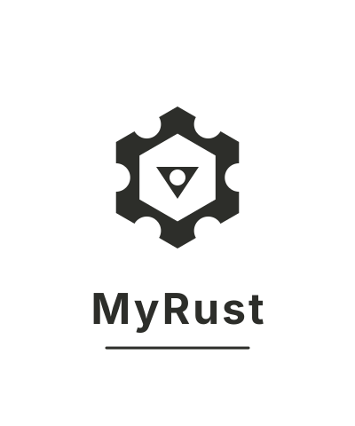

<p align="center">
  
</p>

# MyRust

**Desktop apps in Rust, with a web frontend or a native WebView.**

Each MyRust window loads a **web page** in the system's native WebView — WKWebView on macOS, WebKitGTK on Linux, WebView2 on Windows. Build the frontend with any web framework; it calls your Rust code through typed IPC with auto-generated TypeScript bindings.

- **Pure Rust, no `unsafe`** — the core crate uses `#![forbid(unsafe_code)]`.
- **Typed IPC for pages** — register Rust handlers, generate TypeScript clients automatically; stream values through channels and send typed events.
- **System WebView** — uses the OS-native renderer; small binaries, low memory, instant startup.
- **Dual mode** — the same source runs as a native desktop window or a standalone HTTP server.
- **Desktop APIs** — windows, system tray, notifications, file dialogs, global shortcuts, and a single-instance lock.
- **Hot reload** — watches frontend assets and reloads all WebViews on change.
- **Ready to extend** — workspace structure with a core library, CLI tool, and examples.

## A window with a web page, whose frontend calls Rust

```rust
use myrust_core::app::{App, WindowConfig};
use myrust_core::ipc::{IpcRouter, IpcType, NoRequest};
use myrust_core::webview::{PageSource, WebViewConfig};
use serde::{Serialize, Deserialize};

#[derive(Serialize, Deserialize)]
struct GreetResponse { message: String }

fn main() -> Result<()> {
    let mut app = App::new("my-app")?;
    app.ipc_router().register::<NoRequest, GreetResponse, _>(
        "greet",
        "Returns a greeting.",
        |_| Ok(GreetResponse { message: "Hello from Rust!".into() }),
    )?;

    app.on_ready(|ctx| {
        ctx.create_window(WindowConfig {
            title: "Hello".into(),
            webview: Some(WebViewConfig {
                source: PageSource::Html(HTML.into()),
                devtools: false,
            }),
            ..Default::default()
        })?;
        Ok(())
    });

    app.run()
}
```

```typescript
// Generated — myrust.d.ts
export const greet: () => Promise<GreetResponse>;

// In your page
const res = await greet();
document.body.textContent = res.message;
```

## Getting started

With Rust 1.92+, build the example dashboard:

```bash
# Run in browser mode, then open http://0.0.0.0:8090
cargo run -p dashboard -- --web

# Run as a native desktop window (system WebView)
cargo run -p dashboard

# Generate TypeScript IPC declarations
cargo run -p dashboard -- --generate-ts
```

### CLI

```bash
# Development server with auto-open browser
cargo run -p myrust-cli -- dev

# Release build
cargo run -p myrust-cli -- build
```

### Prerequisites

| Platform | Dependencies |
|----------|-------------|
| **macOS** | Xcode CLI tools (no additional setup) |
| **Linux** | GTK3, WebKitGTK 4.1, AppIndicator |
| **Windows** | WebView2 runtime (shipped with Windows 11) |

Debian / Ubuntu:

```bash
sudo apt-get install libwebkit2gtk-4.1-dev libgtk-3-dev \
  libayatana-appindicator3-dev
```

## Architecture

```
myrust/
├── myrust-core/            # Core library
│   └── src/
│       ├── app.rs          # App lifecycle, multi-window manager
│       ├── webview.rs      # wry WebView wrapper
│       ├── ipc/
│       │   ├── mod.rs      # IPC router + JS bridge
│       │   └── gen.rs      # TypeScript declaration generator
│       └── desktop/
│           ├── tray.rs     # System tray icon + menu
│           ├── notify.rs   # Desktop notifications
│           ├── dialog.rs   # File open/save + message dialogs
│           ├── shortcut.rs # Global keyboard shortcuts
│           └── instance.rs # Single-instance lock
├── myrust-cli/             # CLI (dev server, build)
├── examples/dashboard/     # Dashboard example
└── frontend/               # Web frontend assets
```

## IPC

Register a typed handler on the router:

```rust
router.register::<RequestType, ResponseType, ErrorType>(
    "channel_name",
    "Description of what this handler does.",
    |request| { /* ... */ },
)?;
```

The WebView receives the JavaScript bridge script automatically:

```js
// Request-response
const result = await window.__myrust_ipc__.invoke("channel", payload);

// Listen for Rust-pushed events
window.__myrust_ipc__.on("event_channel", (data) => { /* ... */ });
```

Run with `--generate-ts` to produce `frontend/myrust.d.ts`:

```typescript
export interface Stats {
  cpu: CpuStats;
  memory: MemoryStats;
  disks: DiskStats[];
  // ...
}
export const getStats: () => Promise<Stats>;
```

## Desktop APIs

```rust
// System tray
let tray = tray::TrayBuilder::new("icon.png")
    .on_click(|event| println!("{event:?}"))
    .build()?;

// Notification
notify::send("myrust", "Hello from the system tray", None)?;

// File dialog
let path = dialog::open_file(Some("Choose a file"))?;

// Global shortcut
shortcut::register("Ctrl+Shift+D", || println!("Triggered!"))?;

// Single instance
let _guard = instance::lock("myrust-app")?;
```

## Project status

**Phase 1** — foundation complete. The core crate, WebView wrapper, typed IPC, desktop APIs, CLI, and dashboard example compile and run on all three platforms.

### Roadmap

| Phase | Focus |
|-------|-------|
| **✓ Phase 1** | Multi-window WebView, typed IPC, desktop APIs, CLI |
| **Phase 2** | Menu system, drag & drop, deep links, auto-updater skeleton |
| **Phase 3** | wgpu native UI renderer (flexbox/grid layout, widgets, SVG, Liquid Glass) |
| **Phase 4** | Packaging (.app, .dmg, .msi, .deb, PKGBUILD, code signing, delta updates) |

## License

MIT
